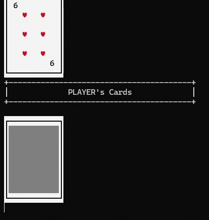
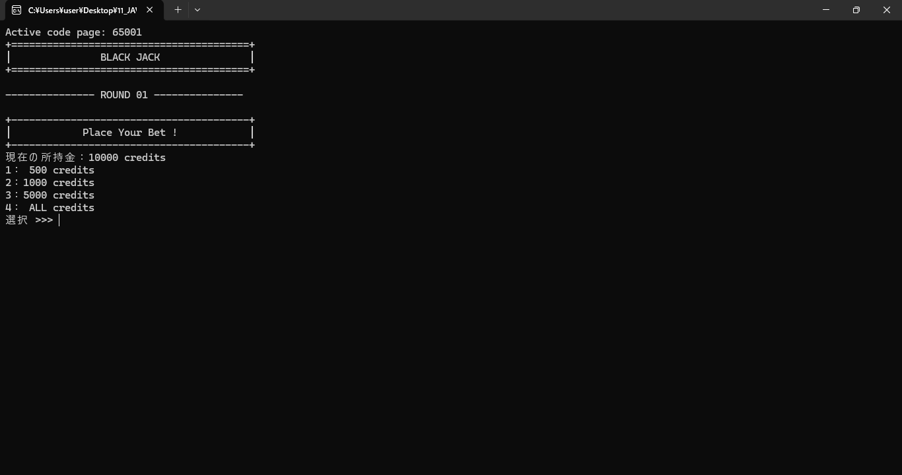
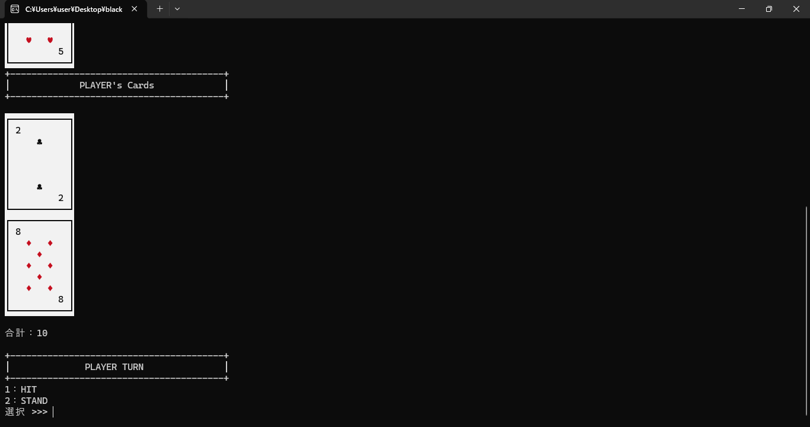
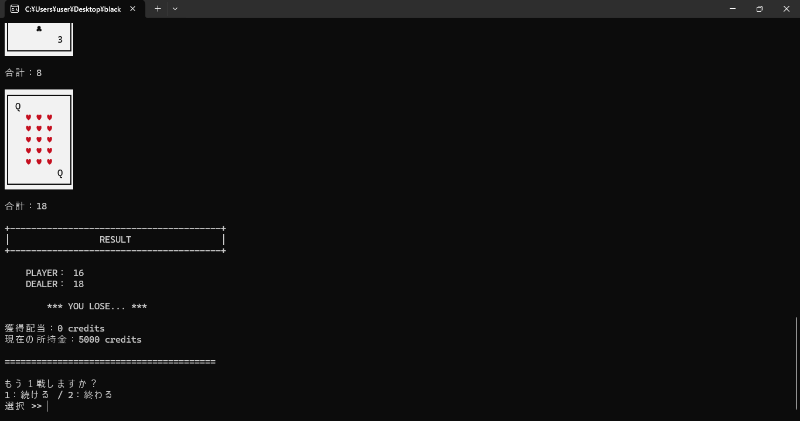

# Black Jack ー Javaコンソールゲーム

Javaで制作した、ターミナルで遊べるブラックジャックです。  
プレイヤーが掛け金を選択し、ディーラーと対戦します。  
カードの表示にはANSIエスケープシーケンスを使い、色分けとカードをめくるアニメーションを実装しています。  

## デモ：カードの反転アニメーション



* カードの幅を段階的に変え、ANSIエスケープシーケンスで前のフレームを描き直すことで、カードが反転する動きを表現しています。

**Windouws版を試す：**[最新リリースからダウンロード](https://github.com/yumeto101-eng/black-jack/releases/latest)

## 主な機能

- **ブラックジャックの基本進行**：掛け金の選択、初期配布、HIT・STAND、ディーラーの行動、勝敗判定
- **スコア計算**：Aを11として計算し、21を超える場合は必要に応じて1として扱う
- **ブラックジャック判定**：最初の2枚で21になった場合の判定と、通常勝利とは異なる配当計算
- **クレジット管理**：初期10,000クレジット、500/1,000/5,000/全額からベットを選択
- **複数ラウンド**：残高が500クレジット未満になるまで、継続して対戦可能
- **カード演出**：カードの絵柄、色分け、反転アニメーションをコンソールに表示
- **デッキ管理**：52枚のカードをシャッフルし、残り枚数が少なくなった際にデッキを再生成

## ゲーム画面

### 1. ゲームプレイ

プレイヤーは所持クレジットから掛け金を選択できます。  
500/1,000/5,000/全額から選べます。  
所持クレジット以上の掛け金を選択すると、掛け金選択に戻ります。



### 2. ゲームプレイ

プレイヤーは手札の合計を確認しながら、  
HIT（カードを引く）またはSTAND（勝負する）を選択できます。  
合計が21以上になると自動でゲームが進行します。



### 3. 勝敗結果

プレイヤーとディーラーの得点を比較し、  
勝敗・獲得配当・現在の所持クレジットを表示します。  
ブラックジャック成立時の特別配当にも対応しています。



## 使用技術

- Java（JDK21でビルド確認）
- Java標準ライブラリ（`List`, `ArrayList`, `Collections`, `Random`, `Scanner`など）
- ANSIエスケープシーケンス（コンソール描画）
- `jar` / `jpackage` （JAR・Windows用EXEの作成）

## 動作方法

### Windows用EXEから起動

GitHubのReleasesにWindows用の配布ZIPを公開した場合は、ZIPを展開し、含まれるBlackJack.exeをダブルクリックしてください。  
jpackageのapp-image形式では、BlackJack.exeだけでなく、同じフォルダのappとruntimeも必要です。  

### ソースコードから実行（PowerShell）

JDK21がインストールされた環境で、Javaソースファイルのあるフォルダを開いて実行します。

```powershell
New-Item -ItemType Directory -Path .\out -Force | Out-Null
javac -encoding UTF-8 -d out Card.java CardRender.java Dealer.java Deck.java GameMaster.java Hand.java Human.java MainBlackJack.java Player.java
java -cp out MainBlackJack
```

実行可能なJARを作る場合：

```powershell
jar cfe black-jack.jar MainBlackJack -C out .
java -jar black-jack.jar
```

※ コンソールで入力するゲームのため、JARのダブルクリックでは画面が表示されない場合があります。上記の`java -jar`コマンドを使用してください。  

## 遊び方

1. 掛け金（500/1.000/5,000/全額）を選択します。
2. プレイヤーとディーラーにそれぞれ2枚のカードが配られます。
3. プレイヤーは**HIT（カードを引く）**または**STAND（引かない）**を選びます。
4. ディーラーは、手札の合計が17以上になるまでカードを引きます（プレイヤーのブラックジャック／バースト時を除く）。
5. 勝敗とクレジットの増減を表示し、続けるか終了するかを選びます。

通常勝利の利益は掛け金と同額、ブラックジャック勝利時の利益はあ掛け金の1.5倍、引き分けは掛け金を返却します。

## クラス構成

| クラス | 主な役割 |
| --- | --- |
| `MainBlackJack` | エントリーポイント、windowsのコンソール文字コード設定 |
| `GameMaster` | ラウンドの進行、入力受付、ベット、勝敗・配当処理 |
| `Card` | カードのスート・ランク・点数・表示文字の管理 |
| `Deck` | 52枚のカード生成、シャッフル、ドロー、デッキ再生成用のしきい値 |
| `Hand` | 手札の保持、点数計算、バースト・ブラックジャック判定 |
| `Human` | プレイヤーとディーラーに共通する名前・手札の管理（抽象クラス） |
| `Player` | プレイヤーのクレジット管理 |
| `Dealer` | ディーラーを表すクラス |
| `CardRender` | ANSIカラーとカード反転アニメーションの描画 |

## 実装で工夫した点

### クラスごとの責務分離

ゲーム進行は`GameMaster`、スコア計算は`Hand`、カード表示は`CardRender`に分け、処理の役割を整理しました。また、共通の名前と手札を持つ`Human`を抽象クラスとし、`Player`と`Dealer`で継承しています。

### A（エース）の点数計算

`Hand#getScore()`では、まずAを11として合計し、21を超える場合はAの
枚数だけ10を減算して1として扱います。Aが複数あるケースにも対応しています。

### コンソール上のカード演出

`CardRender`ではカードの幅を段階的に変え、ANSI制御コードで同じ位置を描き直すことで、カードが回転して表になるような演出を実現しています。

## 今後の改善候補

- ラウンド継続時の入力チェックをより厳密にする
- スコア計算・勝敗判定・配当計算の自動テストを追加する

## 補足

- 表示にはUnicodeのスート記号とANSI制御コードを使用するため、利用するターミナルによって表示が異なる場合があります。
- コンソールゲームとして制作したもので、グラフィカルなウィンドウを備えたGUIアプリではありません。
